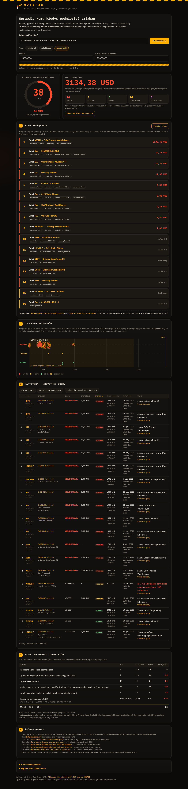
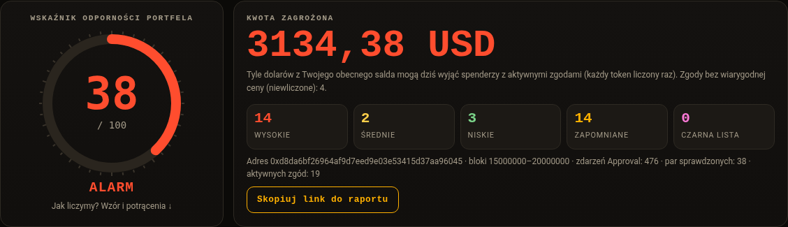
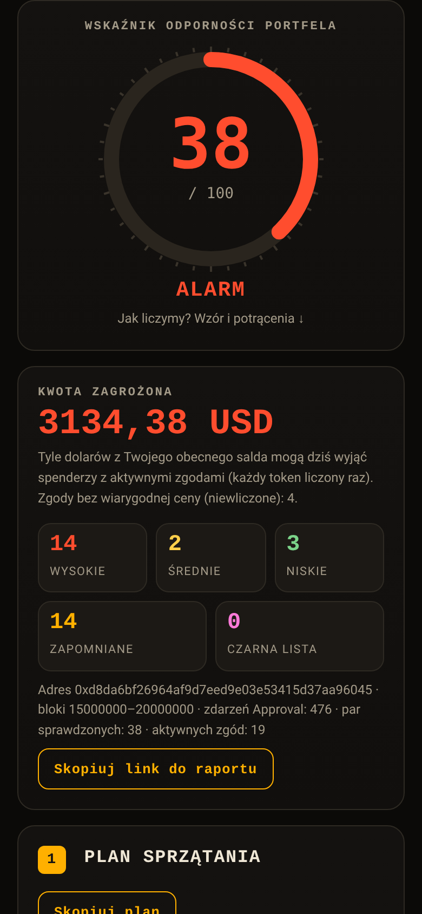

<!-- SPDX-License-Identifier: AGPL-3.0-only -->
<!-- Copyright (C) 2026 Robi (@robi44610) -->
# Szlaban

**Kto ma klucz do Twoich tokenów?** Szlaban to audyt zgód ERC-20 (approvals) na Ethereum. Pokazuje,
ile dolarów z Twojego salda mogą dziś zabrać kontrakty, którym kiedyś dałeś zgodę. Liczy też
Wskaźnik odporności 0–100 według jawnego wzoru i układa plan sprzątania.
**Tylko odczyt:** bez łączenia portfela, bez kluczy i bez transakcji.



[English below](#english)

## Funkcje

- **Kwota zagrożona (USD)**: min(zgoda, saldo) × cena z DefiLlama. W sumie każdy token liczony jest raz.
- **Wskaźnik odporności 0–100**: każde potrącenie jest pokazane i opisane (wzór w [WHITEPAPER.md](WHITEPAPER.md)).
- **Kartoteka spendera**: kontrakt, EOA albo EOA z delegacją EIP-7702, wiek kontraktu (blok utworzenia)
  i trafienia na publicznych czarnych listach.
- **Oś czasu**: kiedy ustawiono każdą zgodę. Zapomniane zgody bez limitu (ponad rok bez zmian) pulsują.
- **Plan sprzątania**: kolejność cofania, linki do Etherscan i revoke.cash, przycisk „Skopiuj plan”.
- **Raport do udostępnienia**: `/r/<adres>?range=year|all|OD-DO`.
- Polski interfejs, ciemny motyw, działa na iPhonie (Safari) i na komputerze.

## Uruchomienie

### Python (bez instalowania czegokolwiek, wystarczy Python ≥ 3.9)

```
python3 server.py              # http://127.0.0.1:8080
PORT=9000 python3 server.py    # inny port
```

### Docker

```
docker build -t szlaban .
docker run --rm -p 8080:8080 --name szlaban szlaban
```

Potem otwórz http://127.0.0.1:8080. Obraz bazuje na oficjalnym `python:3-slim`, działa jako
użytkownik bez uprawnień i ma HEALTHCHECK na `/healthz`.

### Zmienne środowiskowe

| Zmienna | Domyślnie | Znaczenie |
|---|---|---|
| `PORT` / `HOST` | `8080` / `0.0.0.0` | adres nasłuchu |
| `CACHE_TTL` | `600` | ile sekund trzymać wynik w RAM |
| `RATE_MAX` / `RATE_WINDOW` | `10` / `600` | nowe skany na IP w oknie (s) |
| `MAX_RUNNING` | `4` | równoczesne skany |
| `JOB_MAX_SECONDS` | `600` | limit czasu skanu |
| `TRUST_PROXY` | `0` | `1` = ufaj `X-Forwarded-For` (tylko za proxy chmury) |
| `ZGODY_RPC` | – | własne węzły RPC, oddzielone przecinkami (zastępują wbudowane) |
| `ACCESS_LOG` | `1` | `0` wyłącza log żądań (i tak bez adresów i IP) |
| `SOURCE_URL` | `/source.tar.gz` | link do kodu w stopce (np. repozytorium) |

## API

| Metoda | Ścieżka | Opis |
|---|---|---|
| `POST` | `/api/scan` | body `{"address":"0x…","range":"year"\|"all"\|"OD-DO"}` → `202 {"job_id":…}` |
| `GET` | `/api/scan?address=0x…&range=…` | czeka do 20 s; `200` z wynikiem albo `202` z `job_id` |
| `GET` | `/api/job/<id>` | `{"status":"running\|done\|error","progress":0–100,"message":…,"result"\|"error"}` |
| `GET` | `/healthz` | `{"ok":true,…}` |
| `GET` | `/r/<adres>` | raport do udostępnienia |
| `GET` | `/whitepaper`, `/LICENSE`, `/NOTICE`, `/TRADEMARK` | dokumenty |
| `GET` | `/source.tar.gz` | kod źródłowy tej instancji (AGPL §13) |

Błędy: `400` (zły adres, zakres albo JSON), `429` (limit na IP), `503` (serwer zajęty),
`502` (wszystkie węzły zawiodły). Treść błędu jest po polsku w polu `error`.

`result` zawiera m.in.: `summary`, `usd_at_risk_total`, `score{value,grade,deductions[]}`, `plan[]`,
`rows[]` (token, spender, allowance, risk, notes, usd_at_risk, spender_kind,
spender_created_block, spender_age_days, blacklist[], approval_ts, days_since_approval, forgotten,
hidden_unknown, hidden_foreign), `blacklist_sources[]`, `price_source`.

## Testy

```
BASE=http://127.0.0.1:8080 bash tests/test_api.sh     # API (curl)
bash tests/run_e2e.sh                                  # przeglądarka bez okna (node + Chrome)
```

## Binance Guard (`/binance`) – EN / PL / 中文

Osobna sekcja Szlabanu do ochrony konta Binance: **https://szlaban.remi-cloud.workers.dev/binance**.
Interfejs w trzech językach (angielski, polski, chiński uproszczony), język wybierany z przeglądarki
i zapamiętywany. **Niezależne narzędzie, niepowiązane z Binance** (patrz [TRADEMARK.md](TRADEMARK.md)).

1. **Audyt klucza API** – wklejasz klucz tylko do odczytu (HMAC). Raport: wypłaty, handel
   (spot/margin/futures/portfolio margin/opcje), transfery uniwersalne i do subkont, ograniczenie IP,
   wiek klucza, status konta – z poziomem ryzyka i krokami naprawy. Tryb bez klucza: lista kontrolna.
2. **Strażnik adresów wypłat** – pobiera listę zapisanych adresów wypłat, zapisuje punkt odniesienia
   **tylko w przeglądarce** (localStorage; same skróty SHA-256 albo pełne dane) i przy kolejnej kontroli
   pokazuje adresy nowe, usunięte, podmienione pod tą samą etykietą oraz zmiany statusu białej listy.
3. **Wykrywacz fałszywego Binance** – offline w przeglądarce: link, nadawca e-maila, treść SMS.
   Lista oficjalnych domen, homoglify i punycode, literówki, podejrzane końcówki, skracacze, trik z „@”,
   prośby o frazę seed, kody 2FA, zdalny dostęp, „bezpieczny portfel”. Wynik 0–100 z powodami
   i link do oficjalnego [Binance Verify](https://www.binance.com/en/official-verification).

**Ochrona klucza tajnego.** Podpis HMAC-SHA256 powstaje w przeglądarce (WebCrypto, klucz
nieeksportowalny). Binance nie obsługuje CORS dla podpisanych zapytań, więc przeglądarka wysyła do
`POST /api/binance/relay` tylko: nazwę endpointu z listy, API key, `timestamp`, `recvWindow` i gotowy
podpis. Relay odrzuca każde inne pole (np. `secret`), sam składa zapytanie, łączy się tylko z
`https://api.binance.com`, bez przekierowań, z limitem czasu i rozmiaru, nagłówkiem `no-store` i bez
logowania treści (CI sprawdza, że w logach nie ma klucza ani podpisu). Na adresie Cloudflare relay
działa na serwerze brzegowym blisko użytkownika (`cloudflare/worker.js`); na Renderze (USA) Binance
odpowiada HTTP 451, a strona wyjaśnia to i proponuje adres Cloudflare albo uruchomienie lokalne
(`python3 server.py` → http://127.0.0.1:8080/binance). Klucz z ograniczeniem do domowego IP zadziała
tylko przy uruchomieniu lokalnym.

**Endpointy Binance (tylko odczyt), sprawdzone w oficjalnej specyfikacji**
[binance/binance-api-swagger `spot_api.yaml`](https://github.com/binance/binance-api-swagger) i w oficjalnym
[binance-connector-python](https://github.com/binance/binance-connector-python) (`binance_sdk_wallet`):
`GET /sapi/v1/account/apiRestrictions`, `GET /sapi/v1/account/status`,
`GET /sapi/v1/account/apiTradingStatus`, `GET /sapi/v1/capital/withdraw/address/list`, `GET /api/v3/time`.
Podpis zgodny z [rest-api.md „SIGNED … HMAC Keys”](https://github.com/binance/binance-spot-api-docs/blob/master/rest-api.md)
(testy używają wektorów z tej dokumentacji). **Oficjalne domeny** w wykrywaczu: `binance.com`,
`binance.info` (centrum pomocy i Binance Verify), `binance.vision` (serwery API z dokumentacji).
`binance.me`, `binance.us`, `binance.org`, `bnbchain.org` są oznaczane jako „powiązane – sprawdź w Binance Verify”.

Testy: `node tests/test_detector.js`, `node tests/test_bg_core.js`, `node tests/test_worker.mjs`,
`python3 -m unittest tests/test_relay.py`, a e2e w przeglądarce: `node tests/e2e_binance.js` (playwright-core).

## Licencja

**GNU AGPL-3.0-only**, © 2026 Robi (@robi44610), patrz [LICENSE](LICENSE). Kto uruchamia
**zmodyfikowaną** wersję jako usługę sieciową, musi udostępnić jej kod użytkownikom (AGPL, sekcja 13).
Nazwa i logo „Szlaban” nie są licencjonowane dla forków ([TRADEMARK.md](TRADEMARK.md)).
Licencja komercyjna lub zamknięta jest dostępna u autora na prośbę. Źródła danych zewnętrznych są
opisane w [NOTICE](NOTICE).

> Tylko informacje, nie porada finansowa ani usługa bezpieczeństwa. Brak gwarancji. Szlaban nigdy
> nie wykonuje transakcji.

---

## English

**Szlaban** ("boom barrier") audits ERC-20 approvals on Ethereum. It shows how many dollars of your
*current* balance approved spenders could take today, computes a 0–100 resilience score with a
published formula, profiles every spender (contract/EOA/EIP-7702, contract age, public blocklists),
draws a timeline of forgotten unlimited approvals and builds an ordered cleanup plan.
**Read-only:** no wallet connection, no keys, no transactions.

Run with `python3 server.py` (Python ≥ 3.9, standard library only) or with Docker:
`docker build -t szlaban . && docker run --rm -p 8080:8080 szlaban`, then open http://127.0.0.1:8080.
The API is described above, and the method, formula, data sources, threat model and limitations are
in [WHITEPAPER.md](WHITEPAPER.md).

Licence: **AGPL-3.0-only**, © 2026 Robi (@robi44610). If you run a modified version as a network
service you must offer its source to users (AGPL §13). The name and logo are not licensed to forks.
Commercial or closed licensing is available from the author on request. Information only, no warranty.

### Binance Guard (`/binance`)

A separate Szlaban section for Binance account security, fully available in English, Polish and
Simplified Chinese: (1) **API key audit** – withdrawals, trading, transfers, IP restriction, key age and
account status with risk levels and fixes, or a no-key checklist; (2) **withdrawal address guardian** –
baseline of your withdrawal whitelist stored only in your browser, then diffs (new/removed/changed);
(3) **fake-Binance detector** – offline analysis of links, e-mail senders and SMS text with a 0–100
score and a link to the official Binance Verify. The HMAC secret never leaves the browser: requests are
signed with WebCrypto and only the API key plus the finished signature go through a minimal read-only
relay (five allowlisted endpoints, no logs, no storage, `no-store`). Binance blocks US servers (HTTP 451),
so on Cloudflare the relay runs at the edge near you; or run it locally with `python3 server.py`.
**Independent tool – not affiliated with, endorsed or sponsored by Binance.**

### Binance Guard（`/binance`）——中文

Szlaban 的币安账户安全模块，界面完整支持英文、波兰文和简体中文：（1）**API 密钥审计**：检查提现、交易、划转、
IP 限制、密钥创建时间和账户状态，给出风险等级和修复步骤，也可使用无需密钥的检查清单；（2）**提现地址守护**：
基准快照只保存在你的浏览器中，下次检查时显示新增、删除或被替换的地址；（3）**假冒币安检测**：在浏览器内离线分析
链接、邮件发件人和短信内容，给出 0–100 风险分数，并附上币安官方验证渠道链接。Secret Key 从不离开浏览器：
签名由 WebCrypto 完成，只有 API Key 和签名经过极简的只读中转（仅五个白名单接口，不记录、不存储）。
币安会拒绝来自美国服务器的请求（HTTP 451），因此在 Cloudflare 地址上中转在离你最近的边缘节点运行；也可以用
`python3 server.py` 在本地运行。**本工具独立开发，与币安没有任何关联，也未获得其认可或赞助。**

| Desktop | Mobile (390 px) |
|---|---|
|  |  |
